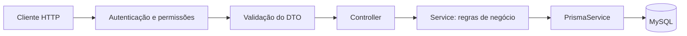
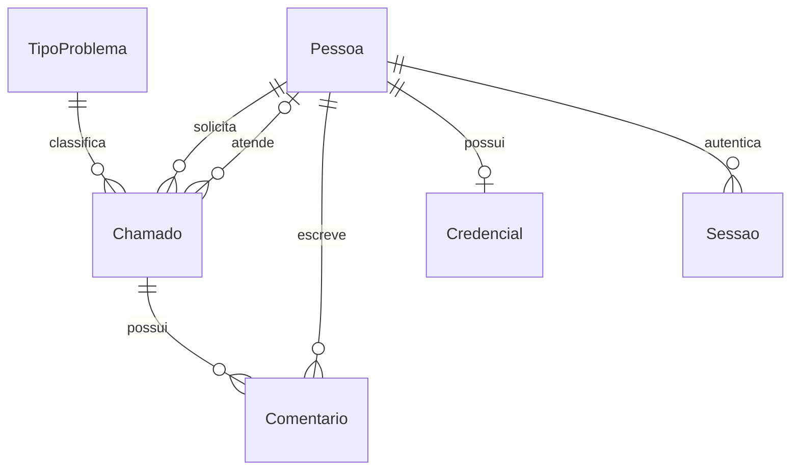

# Arquitetura

A aplicação é uma API NestJS organizada por funcionalidade. A pasta `orm-basico/` mantém o nome do exercício inicial; é nela que ficam todas as dependências e o código executável da API.

## Fluxo de uma requisição

- **Controllers:** definem rotas e recebem dados e identidade da sessão.
- **DTOs:** validam campos e normalizam textos. O `ValidationPipe` global descarta campos desconhecidos.
- **Services:** aplicam as regras de negócio e coordenam transações.
- **PrismaService:** fornece o acesso ao banco por meio do Prisma e do adaptador MariaDB/MySQL.
- **AuthGuard:** autentica o Bearer e restringe operações por perfil.

O solicitante de um chamado e o autor de um comentário são obtidos da sessão, sem confiar em IDs fornecidos no corpo HTTP.

## Módulos

| Pasta em `src/` | Responsabilidade |
| --- | --- |
| `auth/` | Login, sessões, logout, senhas e controle de acesso |
| `pessoas/` | Cadastro, perfil, atividade e proteção do histórico das pessoas |
| `tipos-problema/` | Categorias de problema, ativação e proteção de tipos já usados |
| `chamados/` | Abertura, filtros, edição, designação e transições |
| `comentarios/` | Registro e preservação da conversa do chamado |
| `prisma/` | Conexão e ciclo de vida do acesso ao banco |
| `tarefas/` | CRUD do exercício introdutório |
| `common/` | Recursos compartilhados, incluindo o exemplo de pipe Zod |
| `scripts/` | Provisionamento local de acesso |
| `generated/prisma/` | Client gerado a partir do schema; ignorado pelo Git |

## Modelo de dados

`Chamado` possui um solicitante obrigatório, um tipo de problema e um técnico opcional. O modelo completo, com campos, índices e enums, está em [schema.prisma](../orm-basico/prisma/schema.prisma). As mudanças do banco estão em [prisma/migrations](../orm-basico/prisma/migrations).

O marcador interno `temHistoricoChamados` preserva o envolvimento anterior de pessoas e tipos, inclusive depois de uma troca de técnico. Chaves estrangeiras restringem a remoção de registros referenciados. Comentários não têm rotas de alteração ou exclusão.

## Regras que exigem coordenação

Abertura, designação, mudança de situação e comentário utilizam transações. Bloqueios de linhas coordenam mudanças concorrentes do chamado e das pessoas, protegendo o limite de cinco atendimentos por técnico e as verificações de atividade. Conflitos transacionais `P2034` são repetidos até três tentativas nos fluxos de chamados e comentários.

A senha é armazenada como hash scrypt com salt. A sessão usa um token aleatório de oito horas, cujo hash SHA-256 é persistido no banco. Redefinir senha ou desativar uma pessoa revoga suas sessões.

## Testes e materiais auxiliares

- `src/**/*.spec.ts`: testes unitários.
- `test/*.e2e-spec.ts`: integração da API com MySQL, incluindo regras e concorrência.
- `test/auth.e2e-spec.ts`: integração com o guard real; as demais suítes de negócio substituem o guard para variar identidades.
- `infra/`: scripts opcionais de preparação, fora do código HTTP.
- `exemplos/`: requisições para demonstração manual.
- `index.html` e `tarefas/`: materiais do exercício inicial, preservados para consulta.

O trabalho não inclui frontend de chamados nem processo de hospedagem. Para avaliação, execute a API local e use as requisições e os testes descritos no [README](../README.md).
